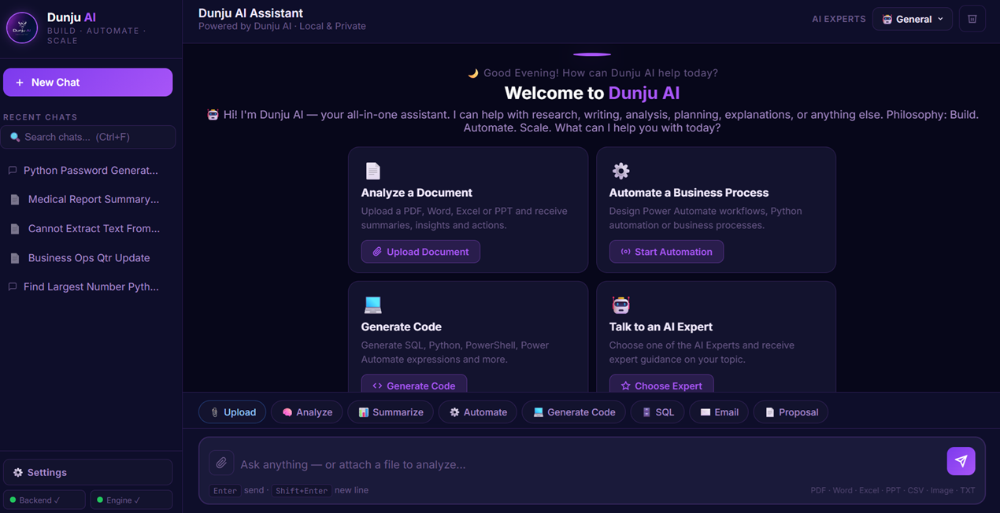

# Dunju Local Custom AI

**A private, fully local AI assistant that runs 100% on your own machine.**

No cloud. No subscription. No API keys. No data collection. Your conversations and documents never leave your computer.



> **Build. Automate. Scale.** — [Dunju AI](https://www.linkedin.com/company/dunju-ai/)

---

## ✨ Features

- **💬 Modern chat interface** — streaming responses, auto-titled chats, full local history, search, duplicate & export chats
- **🧠 6 AI Experts** — General, Business, Coding, Medical, Kids, Fashion — each with its own knowledge focus, personality and smart follow-up actions. Create your own experts without writing code
- **📄 Document Intelligence** — drop in a PDF, Word, Excel or PowerPoint file. Automatic text extraction, document-type detection (invoice, resume, contract, financial report…) and type-specific Smart Actions
- **⚙️ Full control** — temperature, response length, default model & expert, upload limits — all from the Settings panel
- **💾 One-file memory** — every conversation lives in a single SQLite file. One-click backup & restore
- **🔌 Offline by design** — after setup, no internet connection is required

## 🖥️ Requirements

| Component | Minimum |
|---|---|
| OS | Windows 10/11 64-bit |
| RAM | 8 GB (16 GB recommended) |
| Disk | ~10 GB free |
| Software | [Python 3.10+](https://www.python.org/downloads/) · [Ollama](https://ollama.com/download) |

*(The backend is plain FastAPI + SQLite — Linux/macOS users can run `python Source/main.py` directly; only the `.bat` launcher is Windows-specific.)*

## 🚀 Installation

**1. Install [Ollama](https://ollama.com/download)** and verify:
```powershell
ollama --version
```

**2. Install Python 3.10+** (tick *"Add Python to PATH"*), then install dependencies:
```powershell
pip install -r requirements.txt
```

**3. Create the AI model** (first run downloads the ~3.4 GB base model):
```powershell
cd Configurations
ollama create dunju-ai -f Modelfile
```

**4. Start the backend:**
Double-click `Source\Local_Custom_AI_AutoStart.bat` (or run `python Source/main.py`). Keep the console open.

**5. Open the app:**
Open `Source/frontend/DunjuAI_Chat_v5.html` in Chrome or Edge. Check for **Backend ✓** and **Engine ✓** in the sidebar — you're ready.

## 📖 Documentation

The full **[Customer Guide](docs/Dunju_Local_Custom_AI_Customer_Guide_v2.6.0.docx)** covers every feature, all settings (including what temperature and max tokens actually do), document limits, troubleshooting, and keyboard shortcuts.

## 🏗️ Architecture

```
Browser (single HTML file — no build step)
        │  HTTP · localhost only
        ▼
FastAPI backend (Python) — experts · chat memory · documents · settings
        │
        ├──► Ollama (dunju-ai · Qwen3.5 4B) — runs locally
        └──► SQLite — one portable database file
```

Everything runs on `localhost`. Zero external calls.

## ⚠️ Notes & limits

- Documents: the AI reads the first 20 pages / ~15,000 characters per file (configurable in `Source/config/settings.py`)
- The Medical expert provides educational information only — not medical advice
- The backend binds to `0.0.0.0:8000` for local convenience; if your machine is on an untrusted network, change `HOST` to `127.0.0.1` in `Source/config/settings.py`

## 📜 License

[MIT](LICENSE) — free forever. Run it, break it, build on it.

## 💬 Support & contact

- 🐛 Issues and feature requests: use the [GitHub Issues](../../issues) tab
- 📧 Email: dunjuai.work@gmail.com
- 💼 LinkedIn: [Dunju AI](https://www.linkedin.com/company/dunju-ai/) · [Sathya Swaminathan](https://www.linkedin.com/in/sathya-babu-abc529796/)

---

*Made with purpose by [Dunju AI](https://www.linkedin.com/company/dunju-ai/) — Build. Automate. Scale.*
