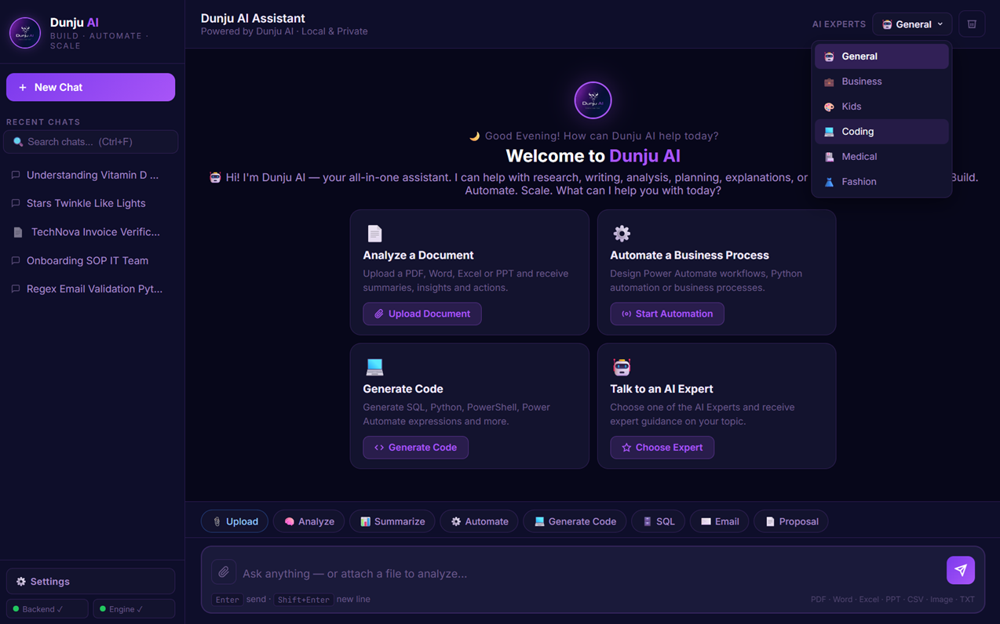
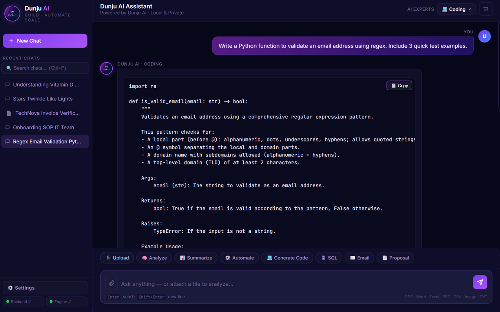
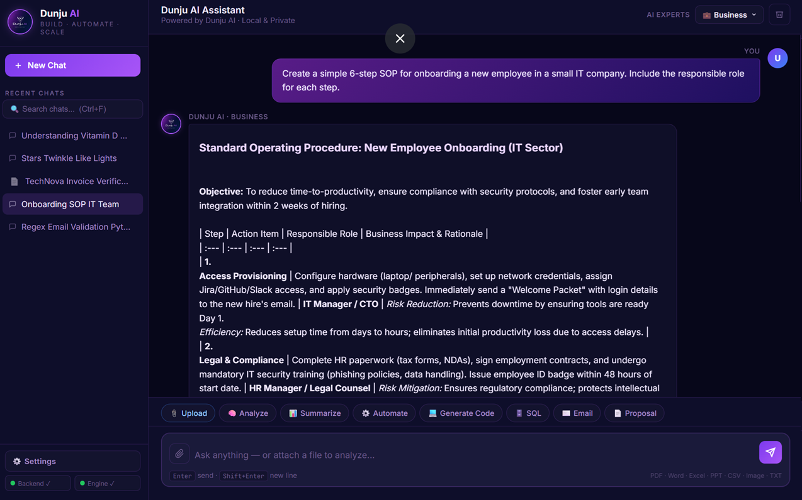
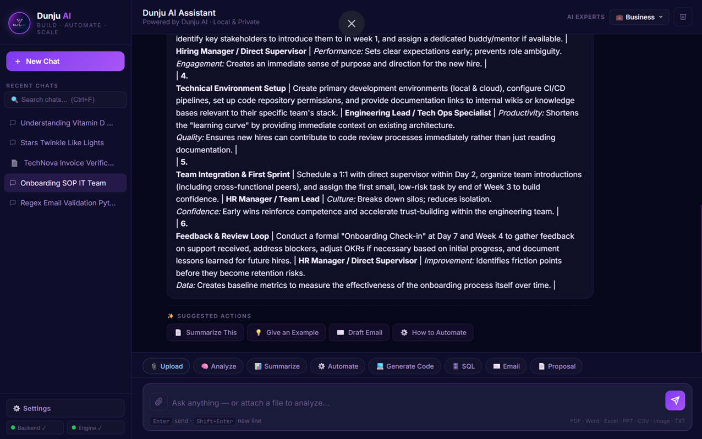
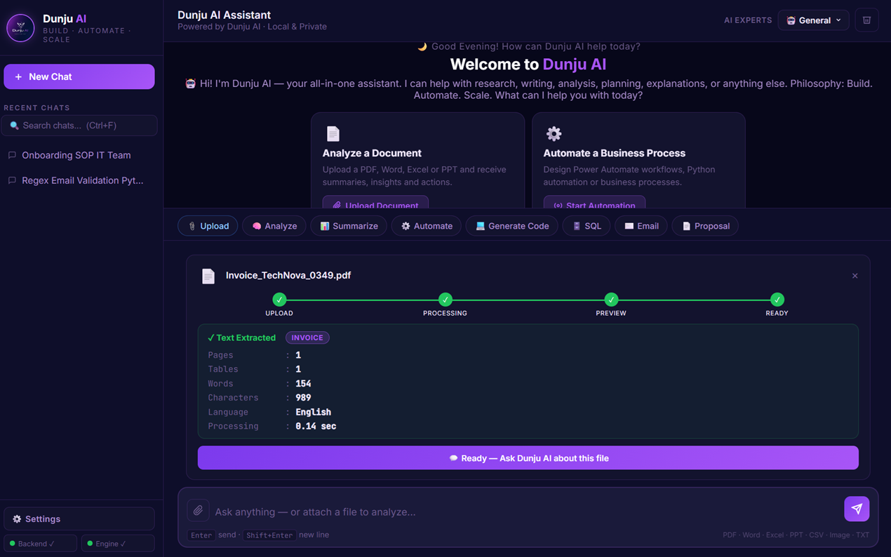
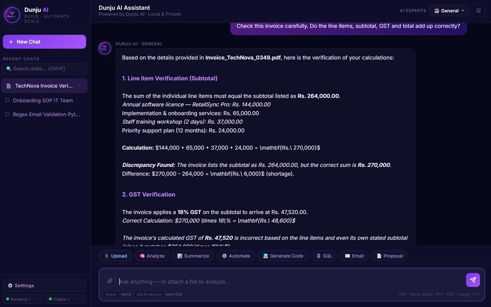
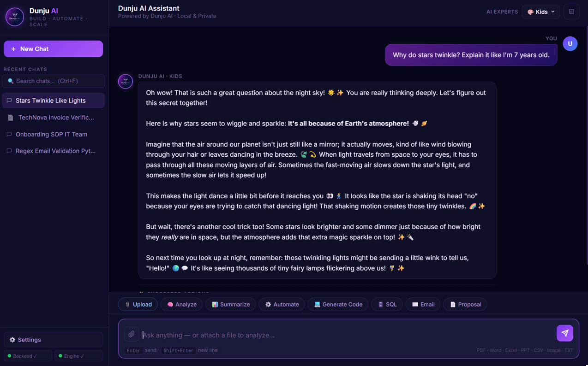
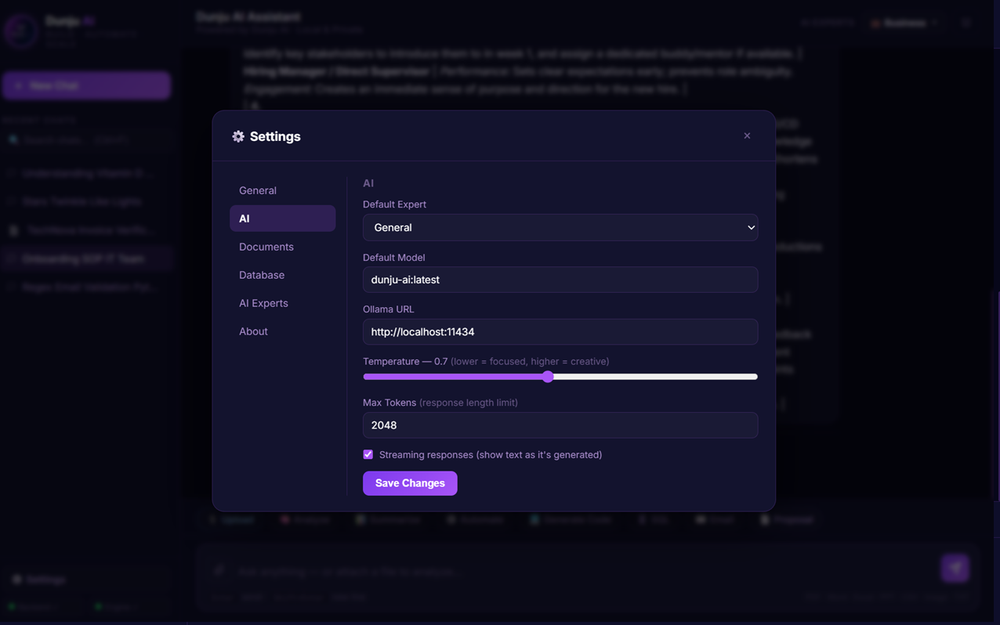

# Dunju Local Custom AI

**A private, fully local AI assistant that runs 100% on your own machine.**

No cloud. No subscription. No API keys. No data collection. Your conversations and documents never leave your computer.

**Version 1.0.1**


> **Build. Automate. Scale.** — [Dunju AI](https://www.linkedin.com/company/dunju-ai/)

---

## ✨ Features

**Chat & experts**
- **💬 Modern chat interface** — streaming responses, auto-titled chats, full local history with search, duplicate & export.
- **🧠 6 AI Experts** — General, Business, Coding, Medical, Kids, Fashion — each with its own focus, personality and smart follow-up actions. Create your own without writing code.
- **🧩 Per-expert model** — pin a different Ollama model to any expert (blank = the default).
- **💭 Reasoning mode** — let the model think through hard problems, shown in a collapsible panel.
- **🔄 Regenerate · ✏️ Edit · 🌿 Branch** — re-run a reply, edit-and-resend, or fork the chat into a new one from any message.
- **📊 Response stats** — generation time, model, tokens and the active expert under every reply.

**Documents & retrieval**
- **📄 Document Intelligence** — PDF, Word (.docx), Excel (.xlsx), PowerPoint (.pptx), CSV, TXT, Markdown and images (OCR is an optional add-on), with automatic type detection (invoice, resume, contract, financial report…) and type-specific Smart Actions.
- **🔍 Smart Retrieval (RAG)** — reads whole documents of *any length*. The file is chunked, embedded with a local model (`nomic-embed-text`) and stored in SQLite; each question retrieves only the relevant passages. Fully offline — no vector database, no cloud.
- **🎯 Hybrid search** — keyword (BM25) + semantic retrieval, so exact names, IDs, SKUs and figures are found reliably.
- **📑 Source citations** — a Sources panel shows the exact passages each answer is based on.

**Output & automation**
- **⬇ Generate documents from chat** — export any reply as Word (.docx), PDF, PowerPoint (.pptx) or Excel (.xlsx); export a whole chat as PDF, Markdown or text.
- **📁 Batch / folder automation** — point Dunju at a folder and run one action (summarize / classify / extract / custom) across every document.

**Settings, data & privacy**
- **⚙️ Full control** — temperature & max-tokens sliders, language, theme, default model & expert, upload limits, and RAG controls — all from Settings.
- **💾 One-file memory** — every conversation in a single SQLite file; one-click backup / restore.
- **🔒 Encrypted backups** — password-protected AES backups. Your live data is never encrypted, so a lost password only affects that one backup.
- **🗒️ Activity log** — a local record of recent events (uploads, expert changes, saves, backups).
- **🔌 Offline by design** — after setup, no internet connection is required.

## 📸 Screenshots

### Six AI Experts, one click away



### Coding expert — complete code with a one-click Copy button



### Business expert — SOPs, proposals and smart follow-up actions





### Document Intelligence — it knows *what* you uploaded

Upload an invoice and watch it detect the type, extract the stats…



…then catch what a human might miss:



### Kids expert — the same AI, a completely different voice



### Full control in Settings



## 🖥️ Requirements

| Component | Minimum |
|---|---|
| OS | Windows 10/11 64-bit |
| RAM | 8 GB (16 GB recommended) |
| Disk | ~10 GB free |
| Software | [Python 3.10+](https://www.python.org/downloads/) · [Ollama](https://ollama.com/download) |

*(The backend is plain FastAPI + SQLite — Linux/macOS users can run `python Source/main.py` directly; only the `.bat` launcher is Windows-specific.)*

## 🚀 Installation

**1. Install [Ollama](https://ollama.com/download)** and verify:
```powershell
ollama --version
```

**2. Install Python 3.10+** (tick *"Add Python to PATH"*), then install dependencies:
```powershell
pip install -r requirements.txt
```
This installs everything, including **reportlab** (Word/PDF/PowerPoint/Excel export) and **cryptography** (encrypted backups).

*Optional:* to read text from **images** (OCR), also run `pip install easyocr`. It is a large download (~2 GB, includes PyTorch), so it isn't installed by default.

**3. Create the AI model** (first run downloads the ~3.4 GB base model):
```powershell
cd Configurations
ollama create dunju-ai -f Modelfile
```

Then pull the embedding model that powers **Smart Retrieval** — this lets Dunju read whole documents of any length:
```powershell
ollama pull nomic-embed-text
```

**4. Start Dunju:**
Double-click `Source\Local_Custom_AI_AutoStart.bat` (or run `python Source/main.py`). Keep the console open. The launcher opens the app in your browser automatically.

**5. Use the app:**
Go to **http://127.0.0.1:8000** in Chrome or Edge (if it didn't open by itself). Check for **Backend ✓** and **Engine ✓** in the sidebar — you're ready.

> Opening `DunjuAI_Chat.html` directly from disk is no longer supported — the backend serves the page, which is what keeps it private (see *Security* below).

## 📖 Documentation

The full **[Customer Guide](docs/Dunju_Local_Custom_AI_Customer_Guide_v1.0.1.docx)** covers every feature, all settings (including what temperature and max tokens actually do), document limits, troubleshooting, and keyboard shortcuts.

## 🏗️ Architecture

```
Browser (single HTML file — no build step)
        │  HTTP · localhost only
        ▼
FastAPI backend (Python) — experts · chat memory · documents · settings
        │
        ├──► Ollama (dunju-ai · Qwen3.5 4B + nomic-embed-text) — runs locally
        └──► SQLite — chat memory · settings · RAG vector store (one portable file)
```

Everything runs on `127.0.0.1`. Zero external calls — no CDNs, web fonts or telemetry.

## 🔒 Security

- The backend listens on **127.0.0.1 only**, so other devices on your network cannot reach it.
- It serves the app page itself, and every API call must carry a **random access token** created each time the backend starts. Other websites open in your browser cannot read that token, so they cannot read or change your chats.
- Requests with an unexpected `Host` header are rejected (protects against DNS-rebinding attacks).
- Everything the AI writes is HTML-escaped before display, so a malicious document cannot inject scripts through the model's reply. A strict Content-Security-Policy blocks the page from contacting any other server.
- If you restart the backend, reload the browser tab to pick up the new token.

## ⚠️ Notes & limits

- Documents: with **Smart Retrieval (RAG)** on, Dunju reads the **whole document** of any length (indexed locally; safety cap 500 pages / 500k chars). Without the `nomic-embed-text` model it falls back to the first 20 pages / ~15,000 characters. All configurable in `Source/config/settings.py`
- The Medical expert provides educational information only — not medical advice
- Old Office 97-2003 formats (.doc, .xls, .ppt) are not supported — save them as .docx / .xlsx / .pptx first
- Upload size limit (default 20 MB) is set in Settings > Documents and enforced by the backend
- **LAN sharing (advanced):** set the environment variables `DUNJU_HOST=0.0.0.0` and `DUNJU_ALLOWED_HOSTS=<your-ip-or-hostname>` before starting. Anyone who can open the page on your network can then use the app and read your chats — only do this on a network you trust

## 🧪 Development

```powershell
pip install -r requirements-dev.txt
python -m pytest
```
Tests use a temporary database and never touch your real `dunju_ai_memory.db`.

## 📜 License

[MIT](LICENSE) — free forever. Run it, break it, build on it.

## 💬 Support & contact

- 🐛 Issues and feature requests: use the [GitHub Issues](../../issues) tab
- 📧 Email: dunjuai.work@gmail.com
- 💼 LinkedIn: [Dunju AI](https://www.linkedin.com/company/dunju-ai/) · [Sathya Swaminathan](https://www.linkedin.com/in/sathya-babu-abc529796/)

---

*Made with purpose by [Dunju AI](https://www.linkedin.com/company/dunju-ai/) — Build. Automate. Scale.*
